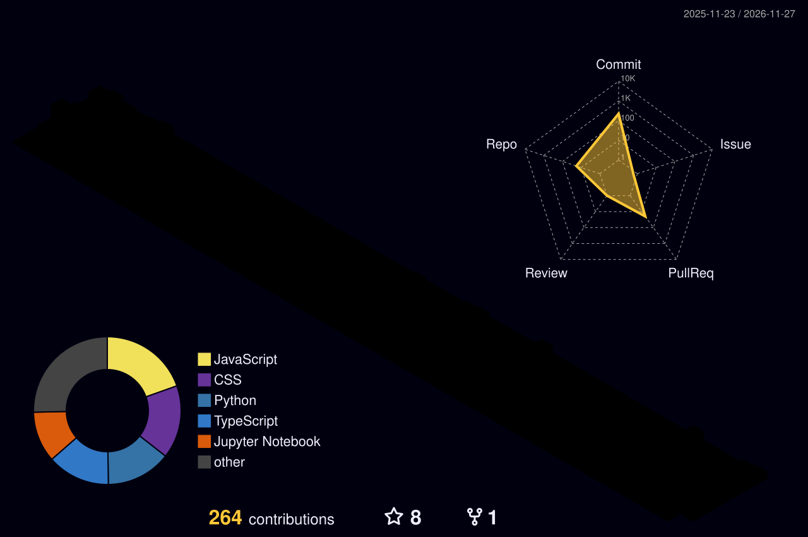

<!-- ═══════════════════════════  HERO  ═══════════════════════════ -->
<div align="center">


<!-- Custom 3D animated neural orb (lives in this repo: assets/neural-orb.svg) -->



<br/>

<a href="https://www.linkedin.com/in/abdul-razaque-744a782a1/"></a>
<a href="https://github.com/abrazzaq02"></a>
<a href="mailto:f23ari02@aror.edu.pk"></a>
<a href="https://www.fiverr.com/"></a>


<a href="https://github.com/abrazzaq02?tab=followers"></a>

</div>


<!-- ═══════════════════════════  ABOUT  ═══════════════════════════ -->
##  About Me

<table>
<tr>
<td width="58%" valign="top">

```python
class AbdulRazaque:
    def __init__(self):
        self.name       = "Abdul Razaque"
        self.role       = "AI Student · ML Engineer · Freelance Dev"
        self.university = "AROR University of Art, Architecture,"
                          " Design & Heritage, Sukkur"
        self.degree     = "B.Sc. Artificial Intelligence"
        self.location   = "Sukkur, Sindh, Pakistan 🇵🇰"
        self.interests  = ["Machine Learning", "Deep Learning",
                           "NLP", "Generative AI"]
        self.goals      = ["ML / Data Science Internship",
                           "Production ML Systems",
                           "Custom ML for SMBs on Fiverr"]

    def philosophy(self):
        return "Don't just build models — deliver measurable impact."

me = AbdulRazaque()
```

</td>
<td width="42%" align="center" valign="middle">


<p align="left">
🔭 Building <b>end-to-end ML pipelines</b><br/>
🧠 Learning <b>Transformers &amp; Attention</b><br/>
🚀 Shipping models with <b>FastAPI / Flask</b><br/>
💼 Offering <b>ML services on Fiverr</b><br/>
⚡ Fun fact: I debug with <code>print()</code> <i>and</i> SHAP
</p>

</td>
</tr>
</table>

<!-- ═══════════════════════════  TECH STACK  ═══════════════════════════ -->
## 🛠️ Tech Stack

<div align="center">


<br/>

<br/>


<br/><br/>


</div>


<!-- ═══════════════════════════  PROJECTS  ═══════════════════════════ -->
## 🚀 Featured Projects

<div align="center">

| | Project | What it does | Stack |
|:-:|---------|--------------|-------|
| 🏠 | **House Price Predictor** | Regression pipeline with SHAP interpretability + REST API | `scikit-learn` `Flask` `Pandas` |
| 📊 | **Sales Forecast Engine** | Time-series forecasting for revenue & inventory planning | `Prophet` `ARIMA` `Streamlit` |
| 🤖 | **Recommender System** | Hybrid collaborative + content-based filtering engine | `scikit-learn` `NumPy` `Flask` |
| 💬 | **NLP Text Classifier** | Multi-class classification with TF-IDF + FastAPI endpoint | `NLTK` `TF-IDF` `FastAPI` |

<a href="https://github.com/abrazzaq02?tab=repositories"></a>

</div>

<!-- ═══════════════════════════  3D CONTRIB  ═══════════════════════════ -->
## 🧊 3D Contribution Skyline

<div align="center">

<!-- Generated daily by .github/workflows/profile-3d.yml -->


</div>

<!-- ═══════════════════════════  ANALYTICS  ═══════════════════════════ -->
## 📈 GitHub Analytics

<div align="center">


</div>

<!-- ═══════════════════════════  CREDENTIALS  ═══════════════════════════ -->
## 🏆 Credentials

<div align="center">


</div>

<!-- ═══════════════════════════  FOCUS  ═══════════════════════════ -->
## 🎯 Current Focus

<div align="center">


</div>

<!-- ═══════════════════════════  SERVICES  ═══════════════════════════ -->
## 💼 Freelance Services

<div align="center">

| 🤖 Custom ML Models | 📊 Predictive Analytics | 🧹 Data Cleaning & EDA | 🚀 Model Deployment | 📉 Optimization |
|:-:|:-:|:-:|:-:|:-:|
| Supervised & unsupervised | Sales, demand & churn | Pipelines & visual reports | Flask / FastAPI / Streamlit | Tuning & evaluation |

</div>

<!-- ═══════════════════════════  SNAKE  ═══════════════════════════ -->
## 🐍 Contribution Snake

<div align="center">

<!-- Generated by .github/workflows/snake.yml -->
<picture>
  <source media="(prefers-color-scheme: dark)" srcset="https://raw.githubusercontent.com/abrazzaq02/abrazzaq02/output/github-snake-dark.svg"/>
  <source media="(prefers-color-scheme: light)" srcset="https://raw.githubusercontent.com/abrazzaq02/abrazzaq02/output/github-snake.svg"/>
  
</picture>

</div>

<!-- ═══════════════════════════  CONNECT  ═══════════════════════════ -->
## 🌐 Connect With Me

<div align="center">

<a href="https://www.linkedin.com/in/abdul-razaque-744a782a1/"></a>
<a href="https://github.com/abrazzaq02"></a>
<a href="mailto:f23ari02@aror.edu.pk"></a>

<br/><br/>


</div>


